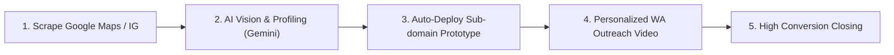
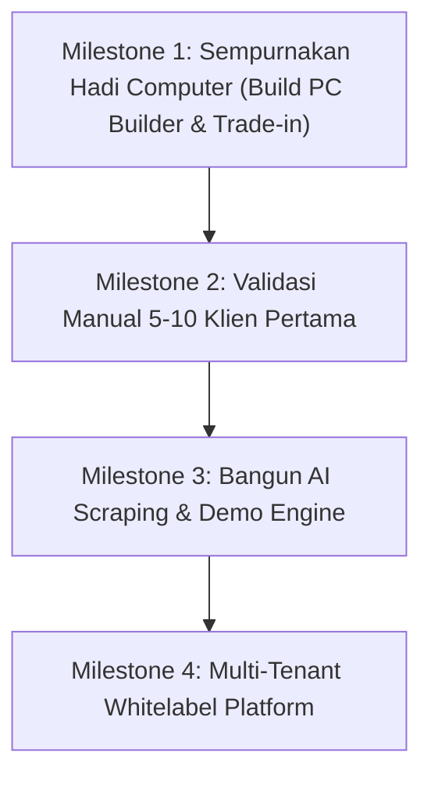

# 🚀 Blue Ocean SaaS: Platform Web Khusus Retailer Komputer & Elektronik

Dokumen ini mendokumentasikan visi, analisis bisnis, kalkulasi harga, arsitektur fitur pembeda, dan strategi *growth* otomatis untuk platform pembuat website vertikal (*vertical SaaS*) khusus toko komputer dan elektronik.

---

## 1. Analisis Peluang & Evaluasi Tanpa Bias

### Mengapa Vertikal Ini Sangat Seksi?
1. **Nilai Transaksi Tinggi (*High Average Order Value*):**
   - Transaksi retail komputer berkisar antara Rp 4.000.000 hingga Rp 40.000.000 per transaksi.
   - Toko tidak membutuhkan ratusan transaksi web per hari; mereka hanya butuh **2–3 transaksi besar ekstra per bulan** lewat web untuk merasa investasi website mereka untung berkali-kali lipat (*instant ROI*).
2. **Kelemahan Marketplace (Shopee/Tokopedia):**
   - Biaya admin marketplace meroket (sekarang 4% – 8.5%). Pada margin tipis produk IT (margin laptop baru hanya 3% – 8%), biaya admin ini memakan seluruh laba toko!
   - Di marketplace, pembeli terdistraksi oleh toko lain yang banting harga 10 ribu perak lebih murah.
   - Toko butuh "kanal resmi" sendiri untuk mengunci pembeli lokal di kotanya (*local presence & trust*).
3. **Kelemahan Generic Website Builder (Shopify/WooCommerce):**
   - Terlalu rumit dan kosong. Pemilik toko komputer tidak punya waktu setup puluhan plugin untuk filter spek (Processor, RAM, VGA, Baru vs Second).
   - Solusi kita adalah produk jadi siap pakai khusus industri komputer.

---

## 2. Fitur Pembeda Utama (Killer Features)

### A. Interactive PC Builder / Simulasi Racik PC
* **Masalah Toko:** Pemilik toko menghabiskan waktu berjam-jam di WhatsApp hanya untuk meracikkan spek PC berulang kali untuk pembeli yang belum tentu beli.
* **Solusi Fitur:**
  1. Halaman interaktif pemilihan komponen: Processor ➡️ Motherboard ➡️ RAM ➡️ VGA ➡️ Storage ➡️ PSU ➡️ Casing ➡️ Monitor.
  2. Filter kompatibilitas otomatis (contoh: jika pilih Intel Gen 14, motherboard yang muncul hanya socket LGA1700).
  3. Indikator estimasi daya listrik (Wattage PSU) dan performa gaming (misal: "Bisa jalan 120 FPS di GTA V & Valorant").
  4. Tombol **"Kirim Rincian Racikan ke WhatsApp Toko"** dengan 1-klik, menyertakan total estimasi harga dan daftar part.

### B. Kalkulator Trade-In / Tukar Tambah Laptop Bekas
* **Mengapa Sangat Menguntungkan?**
  - Margin laba laptop second / bekas jauh lebih tinggi (20% – 35%) dibandingkan laptop baru.
  - Hambatan pembeli: Malas bawa laptop ke toko fisik jika belum tahu kisaran harga jualnya.
* **Alur Pengalaman Pengguna (*User Flow*):**
  1. **Langkah 1 (Identitas Perangkat):** Pilih Merk (Asus, Lenovo, Acer, Apple, HP) & Tipe/Tahun (e.g. Ideapad Slim 3 2022).
  2. **Langkah 2 (Kondisi Hardware):** Pilih Processor (Core i3/i5/Ryzen), RAM, dan kapasitas SSD.
  3. **Langkah 3 (Kondisi Fisik & Kelengkapan):**
     - Fisik: Mulus / Lecet Pemakaian / Ada Dent.
     - Layar & Baterai: Layar Normal / Jamur, Baterai > 2 jam / Bocor.
     - Kelengkapan: Fullset (Dus + Charger) / Unit + Charger Saja.
  4. **Langkah 4 (Hasil Estimasi & CTA):**
     - Muncul perkiraan nilai: *"Estimasi Nilai Tukar: Rp 2.800.000 – Rp 3.400.000"*.
     - Tombol: **"Tukar dengan [Pilihan Laptop Baru] via WhatsApp"**.
     - Pemilik toko menerima pesan terstruktur di WA: data laptop lama + laptop baru incaran customer.

---

## 3. Analisis Harga & Unit Economics

### Biaya Pokok Produksi (HPP per Tenant / Toko):
* **Domain `.com` / `.id`:** Rp 180.000 – Rp 230.000 / tahun.
* **Server Hosting (Next.js Multi-Tenant di VPS / Cloud):**
  - Menggunakan arsitektur multi-tenant dinamis (1 instance melayani banyak sub-domain/custom domain), biaya server terdistribusi.
  - Estimasi beban server per toko: ~Rp 15.000 / bulan (Rp 180.000 / tahun).
* **SSL & CDN (Cloudflare):** Rp 0 (Gratis).
* **Total Biaya Modal per Toko:** ~Rp 400.000 / tahun.

### Rekomendasi Struktur Paket Harga:

| Paket | Target Toko | Fitur Utama | Harga Rekomendasi | Margin Kotor |
| :--- | :--- | :--- | :--- | :--- |
| **Starter (Katalog & WA)** | Toko Service & Aksesoris Kecil | Katalog produk baru/second, WA Closer, CMS simpel, Domain `.com` | **Rp 1.490.000 / tahun** *(atau Rp 150rb/bln)* | ~73% (Laba Rp 1,09 jt/thn) |
| **Pro (Gamer & Specialist)** *(Best Seller)* | Toko Retail Komputer & Rakit PC | Semua fitur Starter + **PC Builder Simulator** + **Kalkulator Trade-In** + SEO Lokal | **Rp 2.790.000 / tahun** *(atau Rp 280rb/bln)* | ~85% (Laba Rp 2,39 jt/thn) |
| **Enterprise (Omnichannel)** | Distributor / Toko Grosir Elektronik | Multi-cabang toko, Instant Checkout (Midtrans/Stripe), POS Sync, API integration | **Rp 4.900.000 / tahun** + Setup | ~90% |

> [!NOTE]
> Menjual di harga **Rp 2,79 Juta / tahun** untuk Paket Pro sangat mudah dijustifikasi ke pemilik toko: **Hanya butuh 1-2 penjualan PC rakitan atau laptop sebulan dari website untuk balik modal setahun penuh.**

---

## 4. Mesin Prospek Otomatis (*AI & Scraping Demo Engine*)

Taktik sales ini memanfaatkan model *Reverse Demo*:

1. **Scraping Engine:**
   - Menelusuri Google Maps API / Crawler dengan kata kunci: *"Toko Komputer [Nama Kota]"*.
   - Mengambil nama toko, nomor telepon/WA, alamat, foto ulasan, dan logo dari Maps.
2. **AI Engine (Gemini Multimodal):**
   - Mengekstrak palet warna dari logo toko (Primary Color, Secondary Color).
   - Menghasilkan slogan atau deskripsi lokal yang relevan dengan nama tokonya.
3. **Pencipta Prototipe Instan:**
   - Script memasukkan data ke template dalam hitungan detik: `nama-toko.tokopc.id`.
4. **Pesan Penawaran Super Personal:**
   - Mengirimkan video rekam layar 30 detik atau screenshot halaman toko mereka yang sudah jadi.
   - Respon pemilik toko: Terkejut dan kagum (*"Kapan mereka bikin ini?"*), peluang closing naik drastis.

---

## 5. Roadmap Eksekusi Bertahap

* **Milestone 1:** Bangun fitur PC Builder & Trade-In Calculator langsung di proyek ini untuk pembuktian konsep dan portofolio nyata.
* **Milestone 2:** Kloning template ini secara manual untuk 5 toko prospek pertama di kota sekitar. Validasi kesediaan bayar (*willingness to pay*).
* **Milestone 3:** Bangun skrip otomasi pembuatan demo dan integrasi AI.
* **Milestone 4:** Rilis platform SaaS mandiri dengan panel pendaftaran otomatis dan integrasi pembayaran.

---

## 6. Fitur Unggulan Mendatang: Smart WhatsApp Broadcast & CRM Engine

### A. Latar Belakang & Kebutuhan Merchant
Pemilik toko komputer sering memiliki ratusan hingga ribuan kontak pelanggan (pelanggan servis, pembeli rakit PC, langganan kantor/sekolah), tetapi nomor tersebut pasif dan jarang di-follow-up. Merchant membutuhkan sarana untuk menyiarkan penawaran promo, restock laptop gaming, atau reminder jadwal servis berkala langsung ke WhatsApp pelanggan tanpa repot mengirim pesan manual satu per satu.

### B. Mekanisme & Syarat Keamanan Meta / Anti-Banned
Mengirim broadcast massal di WhatsApp memiliki risiko tinggi pemblokiran nomor (*banned*) oleh sistem AI Meta jika tidak mengikuti protokol ketat:

1. **Ketentuan Umur Nomor (*Account Warm-up & Aged Number*):**
   - **Syarat Wajib:** Nomor WhatsApp yang digunakan wajib berumur **minimal 3–6 bulan** dan memiliki riwayat percakapan 2 arah yang aktif dan natural.
   - **Peringatan Keras:** Dilarang keras menggunakan nomor perdana baru (*fresh SIM card*). Nomor baru yang langsung mengirim >50 pesan dalam hitungan jam memiliki risiko terblokir 99%.
   
2. **Batas Kuota Pengiriman (*Rate Limiting & Tiered Quota*):**
   - **Tier Akun Baru Bergabung:** Maksimal 50–100 pesan / hari.
   - **Tier Akun Terverifikasi:** Maksimal 250–500 pesan / hari.
   - Pengiriman dipecah menjadi batch kecil dengan jeda dinamis acak (*random delay/jitter*) antara **8 hingga 20 detik per pesan** untuk meniru perilaku manusia.

3. **Personalisasi Pesan Dinamis (*Dynamic Tags & Spintax*):**
   - Mendukung tag personal seperti `{nama_pelanggan}`, `{perangkat_terakhir}`, dan variasi salam otomatis (*Spintax*: `Halo / Selamat Pagi / Hai kak`) agar teks pesan yang dikirim tidak identik 100%.

4. **Klausul Anti-Spam & Tombol Berhenti (*Opt-Out Compliance*):**
   - Di bagian akhir pesan broadcast, wajib disertakan opsi sopan: *"Balas STOP jika tidak ingin menerima info promo ini lagi"*.
   - Jika penerima membalas STOP, sistem secara otomatis memasukkan nomor tersebut ke daftar *Blacklist* agar tidak dikirimi lagi, menjaga reputasi nomor toko tetap aman dari laporan spam (*Report Spam*).

### C. Potensi Monetisasi SaaS
* **Add-On Kuota:** 1.000 pesan broadcast seharga Rp 150.000 / paket.
* **Fitur Eksklusif Paket PRO & Enterprise:** Menjadi nilai jual utama (*upselling*) agar toko upgrade ke paket langganan tahunan yang lebih tinggi.

---

## 7. Roadmap Disepakati — rigspace.id (19 November 2026)

### 7.1 Prinsip Go-To-Market
* **Reverse demo sebagai senjata utama:** datang ke calon tenant dengan website yang **sudah jadi** — brand mereka, produk mereka, desain kita. Momen "WOW" di pertemuan pertama.
* **Jual hasil, bukan website:** inquiry WhatsApp, lead tercatat, keamanan, dan nol maintenance. Desain bagus saja bukan moat.
* **Target operasional:** 1 tenant baru siap dipresentasikan dalam **< 30 menit** (import katalog otomatis + template + branding). Development bukan lagi hambatan; fokus pada penjualan, mulai dari kota-kota besar di Indonesia.
* **Batas custom work:** template + konfigurasi termasuk paket; permintaan custom dibayar terpisah agar model 30 menit/tenant tidak runtuh.
* **Etika demo:** demo memakai brand & produk calon tenant hanya ditunjukkan ke mereka — `noindex`, tidak dipublikasikan, dan dihapus bila mereka menolak.
* **Validasi pasar** = 3–5 toko berbeda membayar + minimal 1 perpanjangan. Klien pertama adalah studi kasus, belum bukti pasar.
* Upgrade paket berikutnya ditawarkan lewat killer feature baru (PC Builder, Trade-In, Broadcast WA, laporan lanjutan) dengan konsekuensi harga paket naik.

### 7.2 Klien Pertama: Bitcom Plaza (Jember)
* Situs lama `bitcomplaza.com`: WordPress + WooCommerce, 250 produk (121 aksesori, 81 laptop, 38 printer, 8 tablet; median Rp 1,2 jt; 89 produk ≥ Rp 4 jt, rata-rata Rp 11,2 jt).
* **Temuan keamanan (19 Nov 2026):** link judi online tersembunyi (`casinoextra.win` digeser −59.028px + `visibility:hidden`; `estelar-bet.cl` dalam kotak tinggi 1px). Tidak terlihat pengunjung, tapi dibaca Google. Cara verifikasi: Ctrl+U → cari "casino", atau Google `site:bitcomplaza.com casino`. Disampaikan sebagai bantuan, bukan serangan.
* **Data katalog:** WooCommerce Store API publik (`/wp-json/wc/store/v1/products`) → impor seluruh 250 produk ke demo; nama dirapikan (hapus akhiran "| BITCOM PLAZA"), spek laptop diekstrak dari judul, kategori dipetakan, "Uncategorized" → Aksesori. Beranda dikurasi ke laptop/printer/tablet; aksesori murah cukup di katalog. Label demo: "Harga mengikuti website lama per [tanggal]".
* **Pitch:** (1) bukti link judi tersembunyi, (2) demo live dengan produk asli mereka, (3) contoh laporan bulanan sederhana.
* **Penawaran:** gratis **1 bulan** dengan syarat langsung live di domain mereka (agar data kunjungan nyata), lalu tahunan. Alternatif bila perlu: bayar tahunan + garansi uang kembali 30 hari setelah live, atau diskon "launch partner" tahun pertama ditukar testimoni & studi kasus.

### 7.3 Urutan Eksekusi
1. **Sprint Fondasi** *(mulai 19 Nov 2026)*
   - Isolasi data tenant di seluruh `/api/admin/*` (filter `tenantId` dari sesi) — wajib sebelum data klien nyata masuk production.
   - Port dari branch `hadicomputer` dan dibuat tenant-aware: RBAC User & Role, soft delete produk, SKU otomatis anti-duplikat, aksi massal (bulk delete).
   - Secret production wajib dari env (`ADMIN_JWT_SECRET`, `GOD_MODE_*`), tanpa fallback hardcoded.
   - Penegakan paket (*plan gating*) untuk fitur Pro.
2. **Import Produk Pintar** — v1 importer WooCommerce (Bitcom & toko WordPress lain); v2 AI import (tempel teks spek / foto / link marketplace) untuk toko non-WordPress.
3. **SEO per tenant (dashboard Pengaturan → SEO):** meta title & description beranda, template judul produk, Open Graph image, sitemap.xml & robots.txt per domain, structured data `Product`/`LocalBusiness`, verifikasi Google Search Console, toggle `noindex` (otomatis aktif untuk demo/prospek).
4. **Google Analytics per tenant:** input Measurement ID GA4 (`G-XXXXXXX`) dan opsional Google Tag Manager di dashboard, disuntikkan hanya di storefront tenant tersebut.
5. **Laporan ROI sederhana (v1):** jumlah chat WhatsApp/bulan & tren, produk paling ditanyakan, asal pengunjung (referrer), jam ramai + penghitung kunjungan ringan. Estimasi omzet & tombol "Tandai Terjual" = fitur upgrade.
6. **Stok produk (opsional):** mode tampil angka / "Stok terbatas" / sembunyikan; ketersediaan otomatis HABIS saat stok 0; stok per varian menyusul; sinkron POS untuk Enterprise.
7. Poles demo Bitcom → presentasi → closing.
8. **Engine tim marketing:** pembuat demo otomatis (scrape Maps/IG, ekstraksi warna logo, import katalog, subdomain demo `noindex`).
9. **Fitur upgrade:** PC Builder, Trade-In, Broadcast WA & CRM, laporan ROI lanjutan, cicilan, cek status servis, notifikasi restock, feed Google Merchant Center, bandingkan produk, inbox lead.
10. Custom domain + SSL otomatis, pendaftaran mandiri, billing (Midtrans/Xendit).
