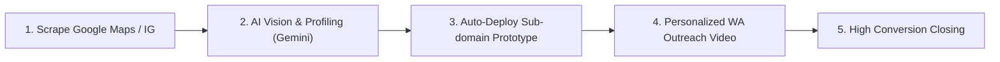
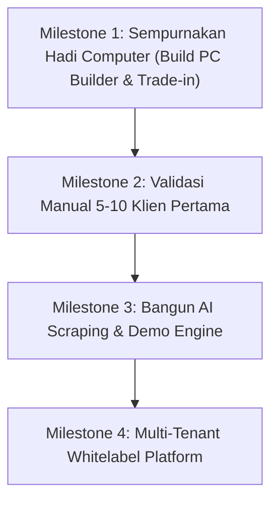

# 🚀 Blue Ocean SaaS: Platform Web Khusus Retailer Komputer & Elektronik

Dokumen ini mendokumentasikan visi, analisis bisnis, kalkulasi harga, arsitektur fitur pembeda, dan strategi *growth* otomatis untuk platform pembuat website vertikal (*vertical SaaS*) khusus toko komputer dan elektronik.

---

## 1. Analisis Peluang & Evaluasi Tanpa Bias

### Mengapa Vertikal Ini Sangat Seksi?
1. **Nilai Transaksi Tinggi (*High Average Order Value*):**
   - Transaksi retail komputer berkisar antara Rp 4.000.000 hingga Rp 40.000.000 per transaksi.
   - Toko tidak membutuhkan ratusan transaksi web per hari; mereka hanya butuh **2–3 transaksi besar ekstra per bulan** lewat web untuk merasa investasi website mereka untung berkali-kali lipat (*instant ROI*).
2. **Kelemahan Marketplace (Shopee/Tokopedia):**
   - Biaya admin marketplace meroket (sekarang 4% – 8.5%). Pada margin tipis produk IT (margin laptop baru hanya 3% – 8%), biaya admin ini memakan seluruh laba toko!
   - Di marketplace, pembeli terdistraksi oleh toko lain yang banting harga 10 ribu perak lebih murah.
   - Toko butuh "kanal resmi" sendiri untuk mengunci pembeli lokal di kotanya (*local presence & trust*).
3. **Kelemahan Generic Website Builder (Shopify/WooCommerce):**
   - Terlalu rumit dan kosong. Pemilik toko komputer tidak punya waktu setup puluhan plugin untuk filter spek (Processor, RAM, VGA, Baru vs Second).
   - Solusi kita adalah produk jadi siap pakai khusus industri komputer.

---

## 2. Fitur Pembeda Utama (Killer Features)

### A. Interactive PC Builder / Simulasi Racik PC
* **Masalah Toko:** Pemilik toko menghabiskan waktu berjam-jam di WhatsApp hanya untuk meracikkan spek PC berulang kali untuk pembeli yang belum tentu beli.
* **Solusi Fitur:**
  1. Halaman interaktif pemilihan komponen: Processor ➡️ Motherboard ➡️ RAM ➡️ VGA ➡️ Storage ➡️ PSU ➡️ Casing ➡️ Monitor.
  2. Filter kompatibilitas otomatis (contoh: jika pilih Intel Gen 14, motherboard yang muncul hanya socket LGA1700).
  3. Indikator estimasi daya listrik (Wattage PSU) dan performa gaming (misal: "Bisa jalan 120 FPS di GTA V & Valorant").
  4. Tombol **"Kirim Rincian Racikan ke WhatsApp Toko"** dengan 1-klik, menyertakan total estimasi harga dan daftar part.

### B. Kalkulator Trade-In / Tukar Tambah Laptop Bekas
* **Mengapa Sangat Menguntungkan?**
  - Margin laba laptop second / bekas jauh lebih tinggi (20% – 35%) dibandingkan laptop baru.
  - Hambatan pembeli: Malas bawa laptop ke toko fisik jika belum tahu kisaran harga jualnya.
* **Alur Pengalaman Pengguna (*User Flow*):**
  1. **Langkah 1 (Identitas Perangkat):** Pilih Merk (Asus, Lenovo, Acer, Apple, HP) & Tipe/Tahun (e.g. Ideapad Slim 3 2022).
  2. **Langkah 2 (Kondisi Hardware):** Pilih Processor (Core i3/i5/Ryzen), RAM, dan kapasitas SSD.
  3. **Langkah 3 (Kondisi Fisik & Kelengkapan):**
     - Fisik: Mulus / Lecet Pemakaian / Ada Dent.
     - Layar & Baterai: Layar Normal / Jamur, Baterai > 2 jam / Bocor.
     - Kelengkapan: Fullset (Dus + Charger) / Unit + Charger Saja.
  4. **Langkah 4 (Hasil Estimasi & CTA):**
     - Muncul perkiraan nilai: *"Estimasi Nilai Tukar: Rp 2.800.000 – Rp 3.400.000"*.
     - Tombol: **"Tukar dengan [Pilihan Laptop Baru] via WhatsApp"**.
     - Pemilik toko menerima pesan terstruktur di WA: data laptop lama + laptop baru incaran customer.

---

## 3. Analisis Harga & Unit Economics

### Biaya Pokok Produksi (HPP per Tenant / Toko):
* **Domain `.com` / `.id`:** Rp 180.000 – Rp 230.000 / tahun.
* **Server Hosting (Next.js Multi-Tenant di VPS / Cloud):**
  - Menggunakan arsitektur multi-tenant dinamis (1 instance melayani banyak sub-domain/custom domain), biaya server terdistribusi.
  - Estimasi beban server per toko: ~Rp 15.000 / bulan (Rp 180.000 / tahun).
* **SSL & CDN (Cloudflare):** Rp 0 (Gratis).
* **Total Biaya Modal per Toko:** ~Rp 400.000 / tahun.

### Rekomendasi Struktur Paket Harga:

| Paket | Target Toko | Fitur Utama | Harga Rekomendasi | Margin Kotor |
| :--- | :--- | :--- | :--- | :--- |
| **Starter (Katalog & WA)** | Toko Service & Aksesoris Kecil | Katalog produk baru/second, WA Closer, CMS simpel, Domain `.com` | **Rp 1.490.000 / tahun** *(atau Rp 150rb/bln)* | ~73% (Laba Rp 1,09 jt/thn) |
| **Pro (Gamer & Specialist)** *(Best Seller)* | Toko Retail Komputer & Rakit PC | Semua fitur Starter + **PC Builder Simulator** + **Kalkulator Trade-In** + SEO Lokal | **Rp 2.790.000 / tahun** *(atau Rp 280rb/bln)* | ~85% (Laba Rp 2,39 jt/thn) |
| **Enterprise (Omnichannel)** | Distributor / Toko Grosir Elektronik | Multi-cabang toko, Instant Checkout (Midtrans/Stripe), POS Sync, API integration | **Rp 4.900.000 / tahun** + Setup | ~90% |

> [!NOTE]
> Menjual di harga **Rp 2,79 Juta / tahun** untuk Paket Pro sangat mudah dijustifikasi ke pemilik toko: **Hanya butuh 1-2 penjualan PC rakitan atau laptop sebulan dari website untuk balik modal setahun penuh.**

---

## 4. Mesin Prospek Otomatis (*AI & Scraping Demo Engine*)

Taktik sales ini memanfaatkan model *Reverse Demo*:

1. **Scraping Engine:**
   - Menelusuri Google Maps API / Crawler dengan kata kunci: *"Toko Komputer [Nama Kota]"*.
   - Mengambil nama toko, nomor telepon/WA, alamat, foto ulasan, dan logo dari Maps.
2. **AI Engine (Gemini Multimodal):**
   - Mengekstrak palet warna dari logo toko (Primary Color, Secondary Color).
   - Menghasilkan slogan atau deskripsi lokal yang relevan dengan nama tokonya.
3. **Pencipta Prototipe Instan:**
   - Script memasukkan data ke template dalam hitungan detik: `nama-toko.tokopc.id`.
4. **Pesan Penawaran Super Personal:**
   - Mengirimkan video rekam layar 30 detik atau screenshot halaman toko mereka yang sudah jadi.
   - Respon pemilik toko: Terkejut dan kagum (*"Kapan mereka bikin ini?"*), peluang closing naik drastis.

---

## 5. Roadmap Eksekusi Bertahap

* **Milestone 1:** Bangun fitur PC Builder & Trade-In Calculator langsung di proyek ini untuk pembuktian konsep dan portofolio nyata.
* **Milestone 2:** Kloning template ini secara manual untuk 5 toko prospek pertama di kota sekitar. Validasi kesediaan bayar (*willingness to pay*).
* **Milestone 3:** Bangun skrip otomasi pembuatan demo dan integrasi AI.
* **Milestone 4:** Rilis platform SaaS mandiri dengan panel pendaftaran otomatis dan integrasi pembayaran.
