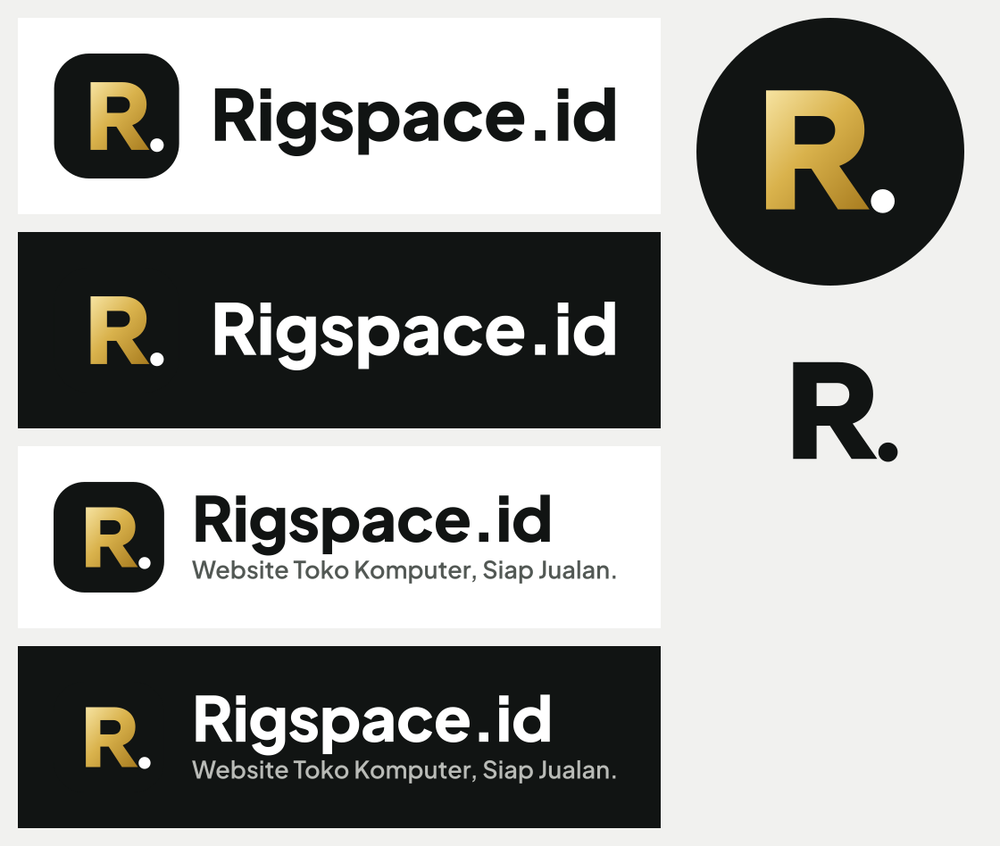

# Rigspace.id — Panduan Logo

Logo diambil 1:1 dari mark CMS (`src/components/admin/rigspace-mark.tsx`): kotak hitam, huruf **R** emas, titik putih (".id").
Tulisan "Rigspace.id" = **Plus Jakarta Sans ExtraBold (800)**, sudah diubah menjadi path (vektor murni). File tidak butuh font terpasang, jadi aman dikirim ke vendor sablon/percetakan.

## Warna

| Nama | Hex | Dipakai untuk |
|---|---|---|
| Ink (hitam) | `#111413` | kotak logo, teks di latar terang |
| Emas terang → emas → emas tua | `#F6E3A1` → `#D9B24C` → `#A87C1F` | gradasi huruf R (layar/digital) |
| Emas flat | `#D9B24C` | huruf R untuk sablon/bordir (1 warna) |
| Putih | `#FFFFFF` | titik ".id", teks di latar gelap |

## File — pilih sesuai kebutuhan

### Avatar Grup WhatsApp
- **Versi kotak (utama):** `png/rigspace-wa-avatar-box-1024.png` (latar putih) atau `png/rigspace-wa-avatar-box-cream-1024.png` (latar krem `#F6F1E3`), tersedia juga ukuran `-640.png`. Kotak hitam + R emas utuh di dalam lingkaran potong WhatsApp.
- Versi tanpa kotak: `png/rigspace-wa-avatar-1024.png` (atau `-640.png`).
- Latar hitam penuh, huruf R di tengah zona aman lingkaran, karena WhatsApp memotong foto menjadi bulat. Jangan pakai `rigspace-mark-1024.png` untuk avatar: sudut kotaknya akan terpotong.

### Baju / Merchandise
| Posisi | File | Catatan |
|---|---|---|
| Dada kiri, kaos **hitam/gelap** | `rigspace-lockup-flat-dark-bg.svg` | lebar cetak ±9–10 cm |
| Dada kiri, kaos **putih/terang** | `rigspace-lockup-light-bg.svg` | lebar cetak ±9–10 cm |
| Punggung (besar) | `rigspace-mark-flat.svg`, atau lockup + tagline | lebar ±25–28 cm |
| Bordir / sablon 1 warna | `rigspace-mark-mono-black.svg` / `rigspace-mark-mono-white.svg` | tanpa kotak & gradasi |
| Lengan | `rigspace-mark-mono-white.svg` | ±5 cm |

- Kirim **file SVG** ke vendor (vektor, tajam di ukuran berapa pun). PNG 3000–4000px disediakan bila vendor minta raster (transparan).
- Gradasi emas sulit disablon (perlu sablon DTF/digital). Untuk sablon plastisol atau bordir, pakai versi **flat** atau **mono**.
- Di kaos hitam, kotak hitam logo menyatu dengan kain. Itu disengaja: yang terlihat huruf R emas dan titik putih.

### Lainnya
- `rigspace-mark.svg` / `png/rigspace-mark-1024.png`: ikon aplikasi, favicon, stiker.
- `rigspace-lockup-*.svg`: kop surat, proposal, slide, banner.
- `rigspace-lockup-tagline-*.svg`: banner pameran, kartu nama sisi belakang, punggung kaos.

## Aturan pemakaian
- Ruang kosong di sekeliling logo minimal setinggi titik ".id" × 3.
- Ukuran minimum lockup: lebar 24 mm (cetak) / 120 px (layar). Di bawah itu, pakai mark saja.
- Jangan: mengubah warna R selain emas/hitam/putih, memiringkan, memberi bayangan/outline, mengganti font tulisan, atau menaruh logo berwarna di atas foto ramai.

## Regenerasi
Aset dibuat oleh skrip sekali jalan (fontkit + sharp) dari path R di `rigspace-mark.tsx`. Bila mark di CMS berubah, file di folder ini perlu dibuat ulang agar tetap sama.
